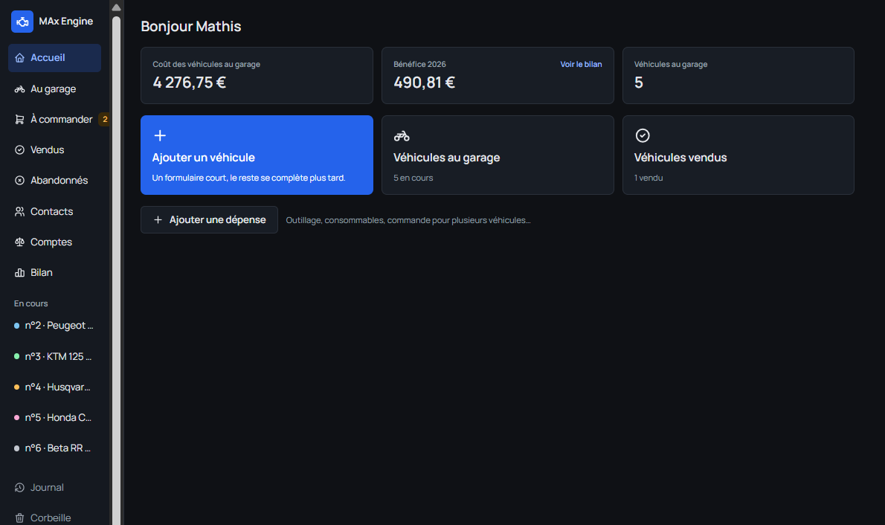
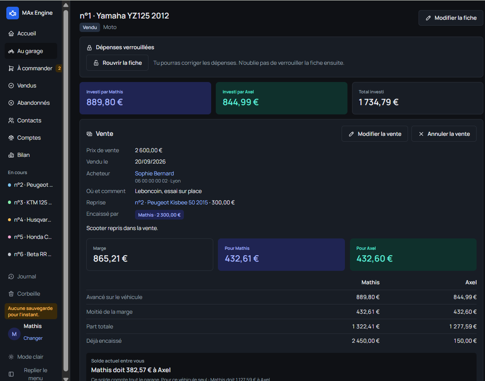
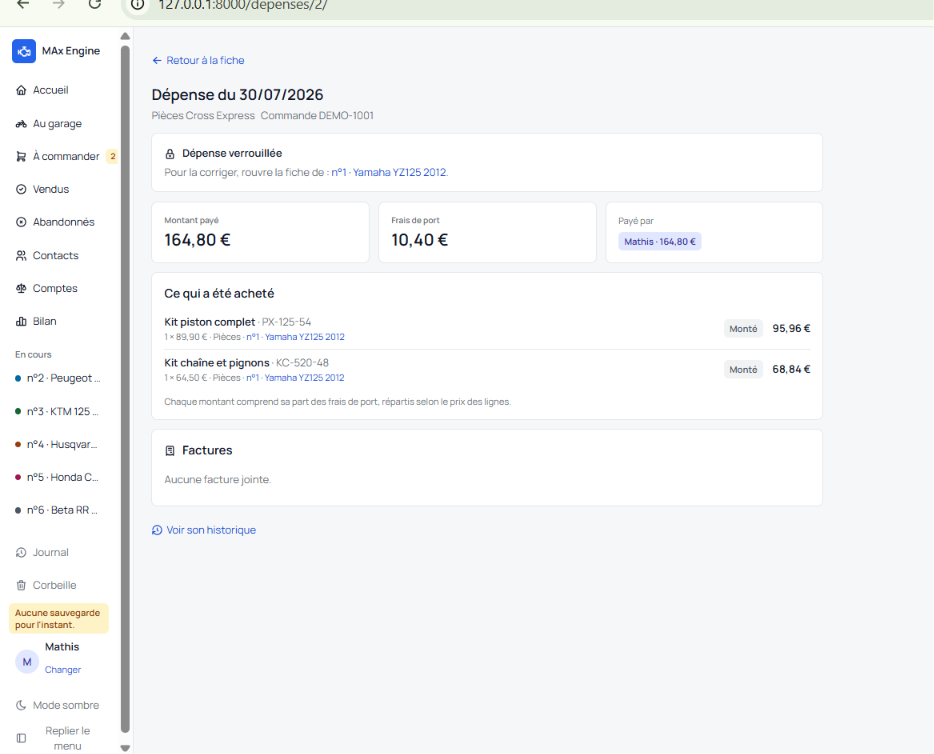
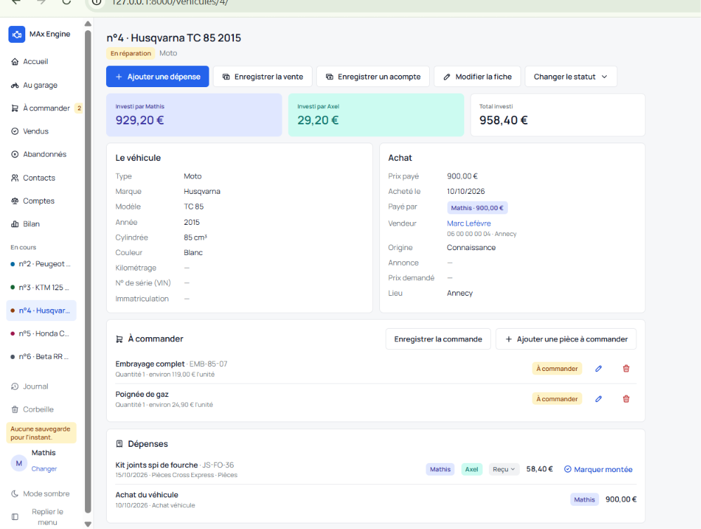
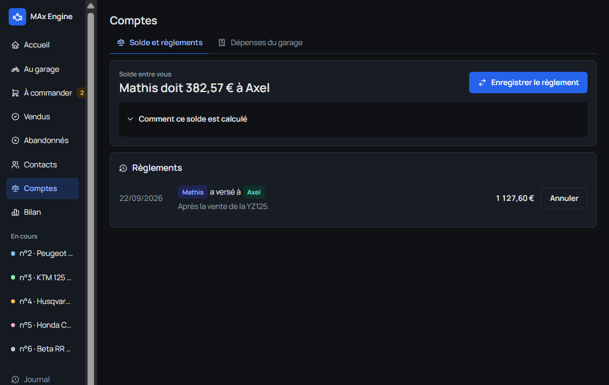
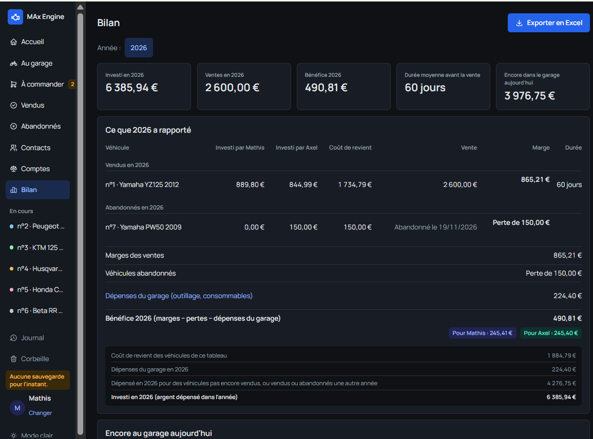

# MAx Engine

Management software for a small used-motorbike trading garage run by two partners in their spare time. It tracks each vehicle from purchase to sale, records expenses and invoices, and splits the money equally between the partners, to the cent.

*Version française complète : [README.md](README.md). The user interface is in French only.*

> **Fictitious data.** Everything in this repository is made up: the partners' first names ("Mathis" and "Axel"), the bikes, contacts, suppliers, amounts, photos (generated images) and screenshots. Test datasets and the demo command contain no real data.

## The problem

The partners used an Excel workbook. Grouped orders (several parts, one payment, shipping costs) were hard to enter, the "who owes whom" calculation had to stay exact after every correction, nothing kept track of changes, and the partner who does the daily data entry needed screens that are obvious without explanation. MAx Engine replaces the workbook with a local, offline application running on a single Windows laptop.

## Features

Vehicles with status timeline, photos and thumbnails, record locked after the sale · expenses with lines, one or two payers, shipping costs spread over the lines, invoices, parts to order, returns and refunds, part transfers · sales with deposits (several instalments), trade-ins and cancellation · partner positions, balance, settlements, yearly and per-vehicle report, Excel export · soft delete with a trash bin, full change history with author, automatic backups, read-only mode, a `controle_comptes` consistency check · light and dark themes, no Internet resources. Not built yet: screens for the work log, tasks and comparable listings (tables already exist), and the PDF sale file.

## Screenshots

Taken on the demo database (`donnees_demo`); the exact pages are listed in [docs/captures/README.md](docs/captures/README.md).

| | |
| --- | --- |
|  |  |
| Home | Sale with trade-in and margin split |
|  |  |
| Shipping spread over the lines | Vehicle under repair |
|  |  |
| Partner accounts | Report (dark theme) |

## Technical choices

Python 3.13, Django 5.2 LTS, SQLite, HTMX + Alpine.js + Tailwind CSS 4 (no Node.js), Waitress and Microsoft Edge in app mode. Every significant decision, with the rejected alternatives, is logged in [docs/decisions.md](docs/decisions.md) (in French); the schema is in [docs/modele-de-donnees.md](docs/modele-de-donnees.md).

## Money rules

All money calculations are **pure functions** in `accounting/services.py`, tested under the `finance` marker; views and templates compute nothing.

- `Decimal` everywhere, `ROUND_HALF_UP` to the cent, never `float`.
- Every euro spent or received belongs half to each partner, whoever paid.
- Balance = half the gap between the two positions (paid out − received), rounded in favour of the partner who advanced the money; a gap of one cent or less counts as settled.
- Shipping = amount paid − sum of the lines, spread pro rata with the largest-remainder method so the total is exact.
- Margin = sale price + kept deposits − cost price. A trade-in is bought half by each partner. Personal purchases are excluded from all calculations.
- A settlement is never edited: it is cancelled by a reverse settlement.

## Try it

```bash
uv sync
uv run python manage.py migrate
uv run python manage.py donnees_demo
uv run python manage.py runserver
```

Open <http://127.0.0.1:8000> and pick a partner. Tests: `uv run pytest` (over 1,400 tests), `uv run pytest -m finance`, `uv run ruff check .`.

## How it was built

MAx Engine is developed with the help of Claude Code (Anthropic's AI), under my direction: I approve a plan before each feature, I decide the business rules (log in `docs/decisions.md`), I test each step with worked numerical cases recalculated by hand, and automated reviews (sub-agents) check the code.

This public version is produced from a private repository by an export script that removes internal working files and anything tied to real data, replaces real names and amounts with invented ones, checks a deny-list, and reruns linting and all tests. It is published in a fresh repository without the private history.

## License

MIT, see [LICENSE](LICENSE). Third-party assets in `static/vendor/` keep their own licenses (Alpine.js and Tabler icons: MIT; Manrope font: SIL OFL 1.1).
