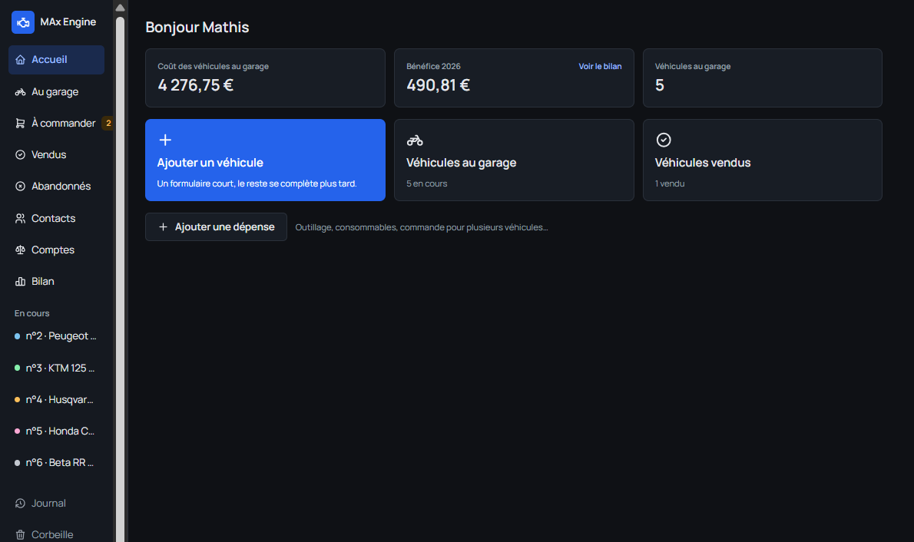
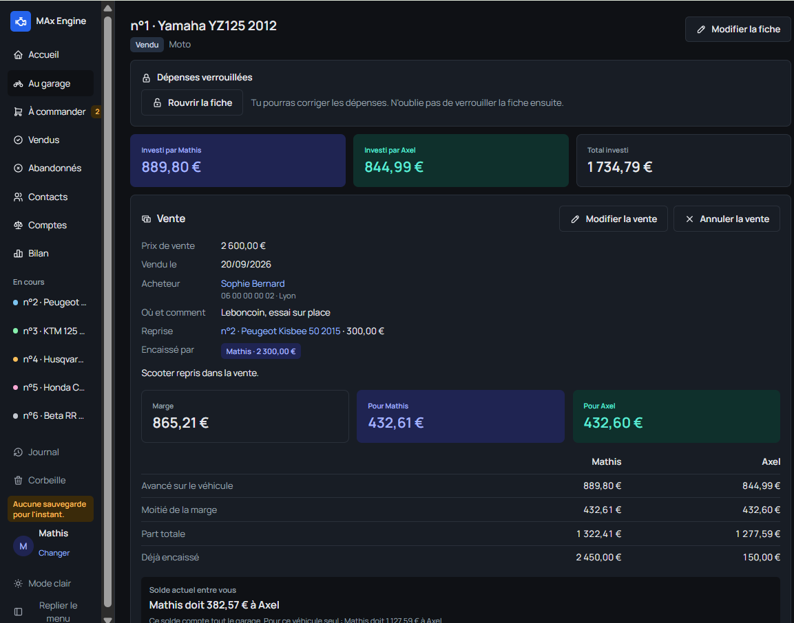
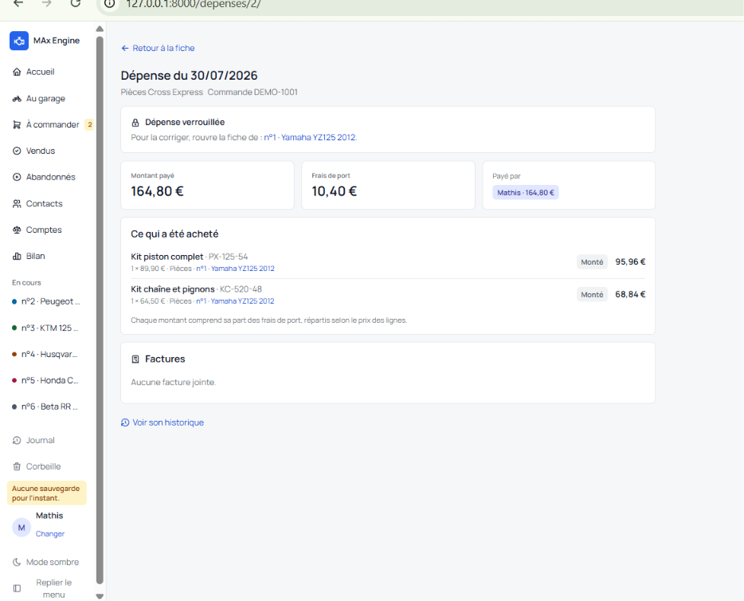
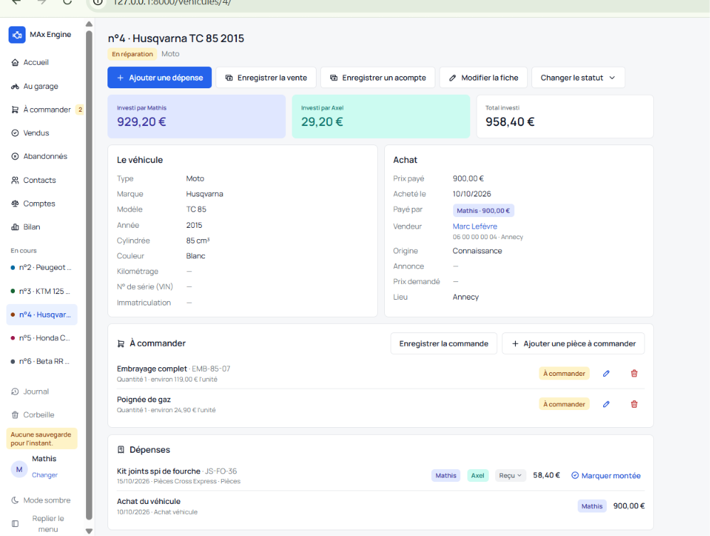
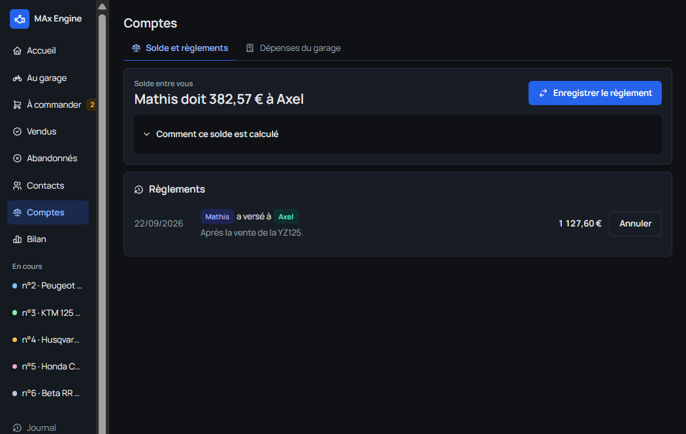
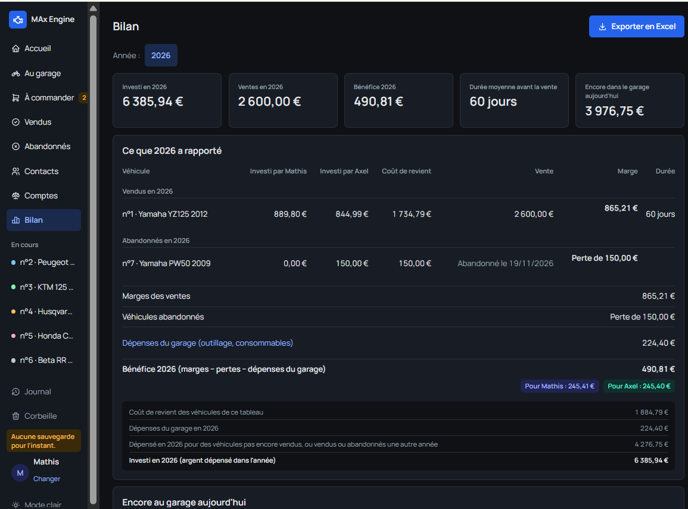

# MAx Engine

Logiciel de gestion pour un petit garage d'achat-revente de motos d'occasion, tenu par moi et mon associé sur notre temps libre. Il suit chaque véhicule de l'achat à la vente, enregistre les dépenses et les factures, et partage l'argent à parts égales entre les associés, au centime près.

*English version: [README.en.md](README.en.md).*

> **Données fictives.** Tout ce que montre ce dépôt est inventé : les prénoms des associés (« Mathis » et « Axel »), les motos, les contacts, les fournisseurs, les montants, les photos (images générées) et les captures d'écran. Les jeux de données des tests et la commande de démonstration ne contiennent aucune donnée réelle.

## Le problème

La gestion était suivie dans un classeur Excel : un registre des motos, un journal des dépenses et une feuille de bilan qui calculait qui doit combien à qui. Seulement, ce classeur montrait ses limites :

- une commande groupée (plusieurs pièces, un seul paiement, des frais de port) se saisissait mal, et les frais de port ne se répartissaient pas sur les pièces ;
- chacun paie selon ses moyens du moment, mais le but est de toujours gagner ou perdre la même somme : le calcul d'égalisation devait être juste au centime, et le rester après une correction ;
- rien ne gardait la trace d'une modification ou d'une suppression ;
- l'associé qui fait la saisie au quotidien n'est pas à l'aise avec l'informatique : il lui fallait des écrans évidents, sans formule à protéger.

MAx Engine remplace ce classeur par une application locale, utilisée sur un pc portable Windows, sans Internet.

## Ce que fait le logiciel

- **Véhicules** : fiche complète, numéro interne jamais réutilisé, statuts (en attente d'achat, acheté, en réparation, prêt à vendre, en vente, réservé, vendu, abandonné) avec leur frise, photos par étape (annonce, avant, pendant, après) et miniatures, fiche verrouillée après la vente (réouverture avec motif).
- **Dépenses** : un paiement avec ses lignes (pièces, sous-traitance, outillage…), payé par un associé ou par les deux ; frais de port calculés et répartis sur les lignes ; factures jointes ; pièces à commander ; retours et remboursements ; transfert d'une pièce d'un véhicule à un autre ; dépenses générales du garage ; achats personnels gardés pour mémoire, hors calculs.
- **Ventes** : encaissements par associé, acomptes (en plusieurs versements, déduits, rendus ou conservés), reprise d'un véhicule dans le prix, annulation d'une vente.
- **Comptes** : position de chaque associé, solde « qui doit combien à qui », règlements entre associés, bilan par véhicule et par année, export Excel.
- **Sécurité des données** : rien n'est supprimé définitivement (corbeille), historique de chaque modification avec son auteur, sauvegarde automatique à la fermeture, mode consultation en lecture seule, commande `controle_comptes` qui vérifie la cohérence de tous les comptes.
- **Interface** : entièrement en français, mode clair et sombre, fonctionne hors ligne (aucune ressource chargée depuis Internet), ouverte dans une fenêtre Microsoft Edge en mode application.

## Captures d'écran

Prises sur la base de démonstration (`donnees_demo`). La liste et les pages exactes sont dans [docs/captures/README.md](docs/captures/README.md).

| | |
| --- | --- |
|  |  |
| Accueil | Vente avec reprise et partage de la marge |
|  |  |
| Frais de port répartis | Véhicule en réparation |
|  |  |
| Comptes entre associés | Bilan (mode sombre) |

## Choix techniques

Chaque choix important est noté, avec ce qui a été écarté et pourquoi, dans le journal [docs/decisions.md](docs/decisions.md) (références Dxx ci-dessous). Le schéma complet est dans [docs/modele-de-donnees.md](docs/modele-de-donnees.md).

| Choix | Raison |
| --- | --- |
| **Python 3.13 et Django 5.2 LTS** (D02) | langage maîtrisé par le développeur, version maintenue jusqu'en 2028, administration de secours fournie |
| **Application locale, sans comptes** (D01) | une seule personne saisit, sur un seul poste : un hébergement en ligne coûterait et exposerait les données sans rien apporter. On choisit simplement « qui suis-je » au lancement |
| **SQLite hors de OneDrive** (D04, D05) | volume faible ; la base vivante n'est jamais dans un dossier synchronisé (risque de corruption), seules ses copies de sauvegarde y vont |
| **HTMX, Alpine.js et Tailwind CSS 4, sans Node.js** (D03, D25) | interface réactive sans framework JavaScript ; le calcul des aperçus (frais de port, reste à encaisser) est fait par le serveur et renvoyé par HTMX, jamais dans le navigateur |
| **Tout servi en local** (D03, D27) | htmx, Alpine, la police Manrope et les icônes Tabler sont dans `static/` : le logiciel marche sans Internet |
| **Serveur Waitress et fenêtre Edge en mode application** (D17) | l'utilisateur double-clique sur une icône et ne voit jamais de terminal |
| **`django-simple-history` et suppression logique** (D13, D30) | chaque modification d'argent ou de statut garde son auteur (l'associé choisi au lancement) ; tout part à la corbeille et se restaure |
| **Montants en `Decimal`** (D07) | jamais de `float` pour de l'argent |

Organisation du code :

| Dossier | Rôle |
| --- | --- |
| `core/` | associés, paramètres, listes modifiables, contacts, fichiers joints, sauvegardes, lanceur |
| `vehicles/` | véhicules, statuts, photos, interventions, tâches, annonces comparables |
| `expenses/` | dépenses, lignes, paiements, fournisseurs, retours, transferts de pièces |
| `sales/` | ventes, encaissements, acomptes, reprises |
| `accounting/` | **tous les calculs d'argent** (`accounting/services.py`), règlements, bilan, export |
| `templates/` | gabarits Django ; `templates/components/` pour les éléments réutilisables |

## Règles financières

Les calculs d'argent vivent tous dans `accounting/services.py`, sous forme de **fonctions pures** (sans base de données) couvertes par des tests marqués `finance`. Les vues et les gabarits ne calculent aucun montant.

1. **Montants exacts.** `DecimalField(max_digits=10, decimal_places=2)` et `Decimal` partout, arrondi `ROUND_HALF_UP` au centime (D07).
2. **Chaque euro appartient pour moitié à chacun** (D08). Peu importe qui a payé : tout ce qui est dépensé ou encaissé pour le garage compte pour moitié à chaque associé. Le temps de travail ne compte pas.
3. **Position et solde.** La position d'un associé est ce qu'il a sorti moins ce qu'il a reçu. Le solde est la moitié de l'écart entre les deux positions, arrondie en faveur de celui qui a avancé. Un écart d'un centime au plus est « à l'équilibre » : sinon, régler un centime ferait passer la dette dans l'autre sens, sans fin (D33).
   *Démo : Mathis a une position de 1 360,40 €, Axel de 2 125,54 € ; écart 765,14 €, donc « Mathis doit 382,57 € à Axel ».*
4. **Frais de port.** Une dépense porte le montant réellement payé et ses lignes ; l'écart entre les deux est réparti sur les lignes au prorata de leur prix. Les centimes d'arrondi sont attribués par la méthode du plus grand reste, pour que la somme retombe exactement sur le montant payé (D10).
   *Démo, commande DEMO-1001 : 164,80 € payés pour 89,90 € + 64,50 € de pièces, soit 10,40 € de frais de port ; coûts répartis 95,96 € et 68,84 €.*
5. **Parts d'une dépense payée à deux.** Le paiement de chaque associé est réparti sur les lignes de la même façon : ses parts somment exactement à ce qu'il a payé, sans centime perdu (D31).
6. **Coût de revient et marge.** Coût de revient = lignes réparties du véhicule (achat compris) moins les remboursements. Marge = prix de la vente non annulée + acomptes conservés − coût de revient (D32).
7. **Reprise.** La valeur d'un véhicule repris compte dans le prix de vente ; le véhicule repris est acheté pour moitié par chaque associé, ce qui est neutre pour le solde (D19).
8. **Achat personnel.** Gardé pour mémoire et exclu de tous les calculs ; il ne peut concerner aucun véhicule (D09, D41).
9. **Vente annulée.** Ses encaissements ne comptent plus, et l'argent rendu à l'acheteur n'est pas une dépense, sinon il serait compté deux fois (D34).
10. **Règlements.** Un règlement entre associés n'est jamais modifié : on l'annule par un règlement inverse, et il ne peut pas dépasser ce qui est dû au moment de l'enregistrer, même avec deux onglets ouverts (D48).

## Essayer en local

Il faut [uv](https://docs.astral.sh/uv/) (qui installe Python 3.13 si besoin). Le serveur de développement de Django fonctionne sous Windows, macOS et Linux.

```bash
uv sync
uv run python manage.py migrate
uv run python manage.py donnees_demo
uv run python manage.py runserver
```

Ouvrir ensuite <http://127.0.0.1:8000>, puis choisir un associé sur la page « Qui es-tu ? ». La base (`donnees/garage.sqlite3`) et les photos (`media/`) sont créées dans le dossier du projet et ignorées par Git. La commande `donnees_demo` refuse une base qui contient déjà des données.

Sous Windows, `uv run python lanceur.py` ouvre le logiciel comme chez l'utilisateur : serveur Waitress et fenêtre Microsoft Edge en mode application.

## Tests et qualité

```bash
uv run pytest              # tous les tests (plus de 1 400)
uv run pytest -m finance   # les calculs d'argent seuls
uv run ruff check .        # qualité du code
uv run python manage.py controle_comptes   # cohérence des comptes de la base
```

Les calculs d'argent sont testés sur des cas chiffrés recalculés à la main : frais de port, centime impair, dépense payée à deux, acompte conservé, reprise, vente annulée, règlement et son annulation, ainsi qu'un jeu de référence de 18 dépenses de la forme du classeur d'origine. Des tests vérifient aussi des invariants sur des scénarios complets (la somme des parts égale toujours le montant payé, un règlement du solde ramène à l'équilibre…).

## Méthode de travail

MAx Engine est développé avec l'aide de Claude Code (IA d'Anthropic), sous ma direction : je valide un plan avant chaque fonctionnalité, je tranche les règles métier (journal `docs/decisions.md`), je teste chaque étape avec des cas chiffrés recalculés à la main, et des relectures automatisées (sous-agents) contrôlent le code.

## À propos de cette version publique

Le logiciel est développé dans un dépôt privé, avec les vraies données du garage. Cette version est produite par un script d'export : il part du dernier commit, retire les fichiers de travail internes et ce qui touche aux vraies données (import du classeur, installation chez l'utilisateur), remplace les prénoms et les montants réels par des valeurs inventées, vérifie qu'aucun mot d'une liste interdite ne subsiste, puis relance la qualité et tous les tests. Elle est publiée dans un dépôt neuf, sans l'historique privé.

Pas encore fait, prévu dans une étape suivante : les écrans du journal des interventions, des tâches et des annonces comparables (les tables existent déjà, et la démo les remplit), et le dossier de vente en PDF (version acheteur et version interne).

## Licence

Code sous licence MIT : voir [LICENSE](LICENSE). Les ressources tierces de `static/vendor/` gardent leur licence : Alpine.js (MIT), icônes Tabler (MIT), police Manrope (SIL Open Font License 1.1) ; détail dans [static/vendor/README.md](static/vendor/README.md).
